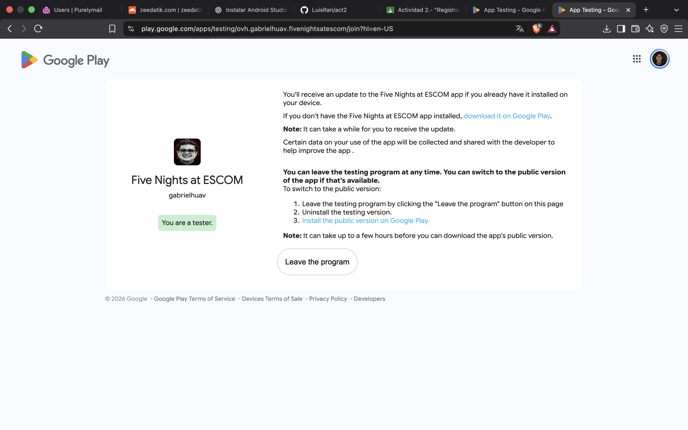
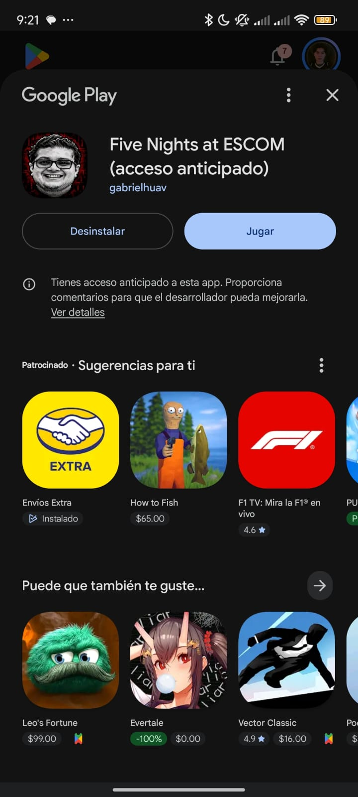
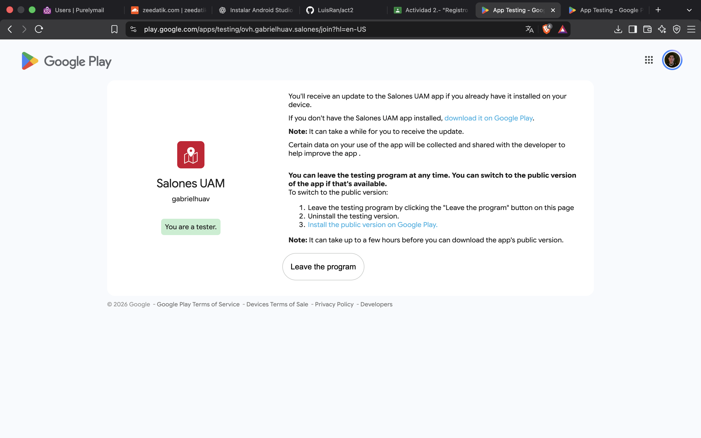
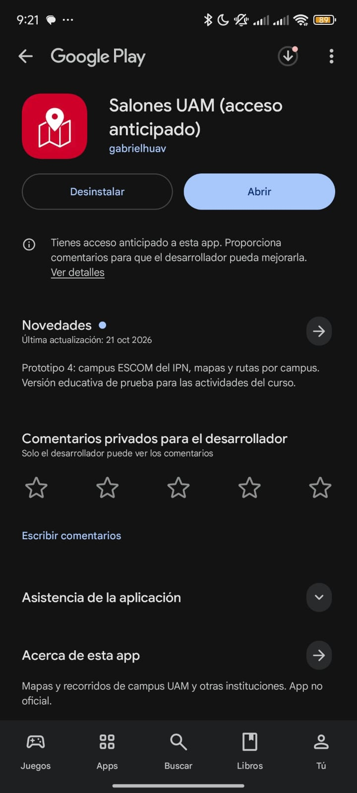

# Actividad 2.- Registro en pruebas cerradas y retroalimentación de aplicaciones móviles

**Instituto Politécnico Nacional – Escuela Superior de Cómputo**
Ingeniería en Sistemas Computacionales (Plan 2020)

| | |
|---|---|
| **Alumno** | Rangel Mata José Luis |
| **Boleta** | 2023630577 |
| **Grupo** | 7CV4 |
| **Asignatura** | Desarrollo de aplicaciones móviles nativas |
| **Profesor** | Gabriel Hurtado Avilés |
| **Fecha** | 5 de noviembre de 2026 |

---

## Aplicación 1. Five Nights at ESCOM

- Inscripción: https://play.google.com/apps/testing/ovh.gabrielhuav.fivenightsatescom
- Ficha de Google Play: https://play.google.com/store/apps/details?id=ovh.gabrielhuav.fivenightsatescom

### Inscripción a la prueba cerrada

### Aplicación instalada

### Observación

La instalación desde Google Play se completó correctamente (botones *Desinstalar* y *Jugar*, prueba cerrada activa en mi cuenta).

- **Positivo:** es un juego basado en la mecánica de Five Nights at Freddy's (un fork) ambientado en la ESCOM; la propuesta resulta divertida.
- **Problema 1:** de vez en cuando se traba al cambiar entre cámaras.
- **Problema 2:** de diseño: solo hay una puerta, a la derecha de la posición del jugador, para cuidarse, lo que limita la defensa y la variedad de la jugabilidad. Sugerencia: agregar más puntos de defensa.

---

## Aplicación 2. Salones (Salones UAM)

- Inscripción: https://play.google.com/apps/testing/ovh.gabrielhuav.salones
- Ficha de Google Play: https://play.google.com/store/apps/details?id=ovh.gabrielhuav.salones

### Inscripción a la prueba cerrada

### Aplicación instalada

### Observación

La instalación desde Google Play se completó correctamente (botones *Desinstalar* y *Abrir*). La última actualización es del 21 de octubre de 2026 («Prototipo 4: campus ESCOM del IPN, mapas y rutas por campus»).

- **Positivo:** la interfaz es sencilla y fácil de usar.
- **Problema 1:** si el usuario está lejos de la escuela, la app lo lleva a su ubicación actual en lugar de mostrar el mapa del campus UAM. Sugerencia: abrir por defecto en el campus, o dar una opción para elegirlo.
- **Problema 2:** la versión 3D se ralentiza (bajo rendimiento). Sugerencia: optimizar o ofrecer una calidad gráfica reducida.
